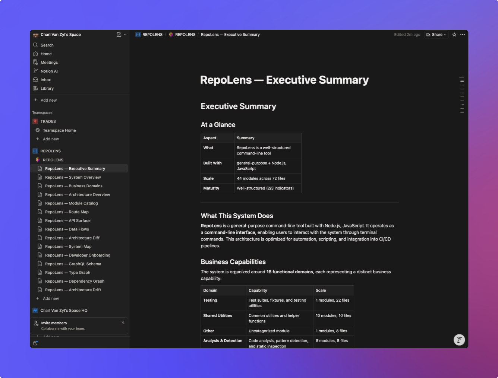
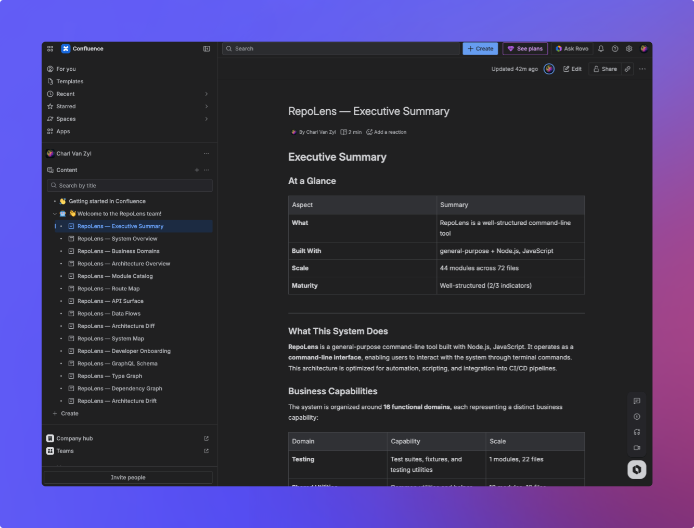

```
    ██████╗ ███████╗██████╗  ██████╗ ██╗     ███████╗███╗   ██╗███████╗
    ██╔══██╗██╔════╝██╔══██╗██╔═══██╗██║     ██╔════╝████╗  ██║██╔════╝
    ██████╔╝█████╗  ██████╔╝██║   ██║██║     █████╗  ██╔██╗ ██║███████╗
    ██╔══██╗██╔══╝  ██╔═══╝ ██║   ██║██║     ██╔══╝  ██║╚██╗██║╚════██║
    ██║  ██║███████╗██║     ╚██████╔╝███████╗███████╗██║ ╚████║███████║
    ╚═╝  ╚═╝╚══════╝╚═╝      ╚═════╝ ╚══════╝╚══════╝╚═╝  ╚═══╝╚══════╝
                        Repository Intelligence CLI
```

[](https://www.npmjs.com/package/@chappibunny/repolens)
[](https://marketplace.visualstudio.com/items?itemName=repolensdox.repolensdox)
[](https://github.com/CHAPIBUNNY/repolens/actions/workflows/test.yml)
[](LICENSE)
[](https://registry.modelcontextprotocol.io/v0/servers?search=io.github.CHAPIBUNNY/repolens)
[](https://chapibunny.github.io/repolens/)
[](https://cursor.com/install-mcp?name=repolens&config=eyJjb21tYW5kIjoibnB4IiwiYXJncyI6WyIteSIsIkBjaGFwcGlidW5ueS9yZXBvbGVucyIsIm1jcCJdfQ%3D%3D)
[](https://insiders.vscode.dev/redirect/mcp/install?name=repolens&config=%7B%22command%22%3A%22npx%22%2C%22args%22%3A%5B%22-y%22%2C%22%40chappibunny%2Frepolens%22%2C%22mcp%22%5D%7D)

**Links:** [Gallery](https://chapibunny.github.io/repolens/) · [npm](https://www.npmjs.com/package/@chappibunny/repolens) · [MCP Registry](https://registry.modelcontextprotocol.io/v0/servers?search=io.github.CHAPIBUNNY/repolens) · [MCP Rush](https://mcprush.com/to/chapibunny-repolens-mcp?ref=badge) · [VS Code extension](https://marketplace.visualstudio.com/items?itemName=repolensdox.repolensdox) · [GitHub Action](action.yml)

**Your architecture docs are already outdated.** RepoLens fixes that.

RepoLens scans your repository, generates living architecture documentation, and publishes it to Notion, Confluence, GitHub Wiki, Obsidian, or Markdown — automatically on every push. Engineers get technical docs. Stakeholders get readable system overviews. Nobody writes a word.

> Stable as of v1.0 — [API guarantees](docs/STABILITY.md) · [Security hardened](SECURITY.md) · version from [`package.json`](package.json)

---

## 🎬 Demo

> **Try it now** — no installation required. `npx @chappibunny/repolens demo` previews the repository you point it at. It detects common languages (Python, Go, Rust, Java, JavaScript/TypeScript, and others). If the scan matches no source files, demo exits 2 and does not write empty docs. Code health scores JavaScript/TypeScript, Python, and Go.

**[See it on real repos](https://chapibunny.github.io/repolens/)** — architecture pages RepoLens generated for Express, FastAPI, Django, Gin, mdBook, and other public projects. Deterministic mode, no API keys.

🎬 **[Watch Demo Video](https://www.loom.com/share/8e077624e69f41319fd93acbbe03871e)** — See RepoLens generate docs in 60 seconds

<table>
<tr>
<td width="50%"></td>
<td width="50%"></td>
</tr>
<tr>
<td align="center"><em>Notion</em></td>
<td align="center"><em>Confluence</em></td>
</tr>
</table>

<details>
<summary>🔍 <strong>Supported Languages</strong> (16 auto-detected)</summary>

`JavaScript` `TypeScript` `Python` `Go` `Rust` `Java` `C` `C++` `C#` `Ruby` `PHP` `Swift` `Kotlin` `Scala` `Shell` `SQL`

Plus framework detection: **Django** · **FastAPI** · **Flask** · **Gin** · **Echo** · **Fiber** · **Actix** · **Rocket** — and all major JS frameworks (React, Next.js, Vue, Angular, Express, NestJS, Svelte, etc.)
</details>

---

## 🚀 Quick Start (60 seconds)

**Step 1: Install** (Node.js 18+)
```bash
npm install @chappibunny/repolens
```

**Step 2: Initialize** (creates config + GitHub Actions workflow)
```bash
npx @chappibunny/repolens init
```

**Step 3: Configure Publishing** (optional, skip if using Markdown only)

For Notion:
```bash
# Edit .env and add:
NOTION_TOKEN=secret_xxx
NOTION_PARENT_PAGE_ID=xxx
```

For Confluence:
```bash
# Edit .env and add:
CONFLUENCE_URL=https://your-company.atlassian.net/wiki
CONFLUENCE_EMAIL=your-email@example.com
CONFLUENCE_API_TOKEN=your-token
CONFLUENCE_SPACE_KEY=DOCS
```

**Step 4: Publish**
```bash
npx @chappibunny/repolens publish
```

**Done!** Numbered notes and the Markdown publisher’s files are in `.repolens/`. Notion, Confluence, GitHub Wiki, and Obsidian publish only when you configure them. Obsidian needs `obsidian.vault` in `.repolens.yml` and does not use an API key.

**🔄 Upgrading from v0.3.0 or earlier?**
Run `npx @chappibunny/repolens migrate` to automatically update your workflow files. See [MIGRATION.md](docs/MIGRATION.md) for details.

---

## 📋 What It Generates

**17 document types** for three audiences — no manual writing required. Route Map and GraphQL Schema are skipped when the repository has no routes or GraphQL schema:

| Audience | Documents |
|---|---|
| **Stakeholders** | Executive Summary |
| **Mixed** | System Overview · Business Domains · Route Map · Data Flows · Change Impact · System Map · Architecture Drift · Code Health |
| **Engineers** | Architecture Overview · Module Catalog · API Surface · Developer Onboarding · GraphQL Schema · TypeScript Type Graph · Dependency Graph · Security Hotspots |

**Two modes:** Deterministic (free, fast, always works) or AI-Enhanced (optional — GitHub Models, OpenAI, Anthropic, Google, Azure, Ollama).

---

## ✨ Why RepoLens

| | |
|---|---|
| 🤖 **Autonomous** | Runs on every push via GitHub Actions — docs stay evergreen |
| 👥 **Multi-Audience** | Technical docs + stakeholder-readable overviews from one scan |
| 📤 **Multi-Publisher** | Notion, Confluence, GitHub Wiki, Obsidian, Markdown — together or one at a time |
| 🗺️ **Shows what you didn't ask** | An LLM only answers the question it is given, and a newcomer doesn't know what to ask. RepoLens publishes the whole map (every module, cycle and hub) on every PR, the same way each time, with no tokens spent per question |
| 🧠 **AI-Assisted** | Optional AI with zero-hallucination policy (structured context only) |
| 🔍 **Smart Detection** | Frameworks, domains, data flows, dependencies, drift — all automatic |
| 🔌 **Extensible** | Plugin system for custom renderers, publishers, and hooks |
| 🛡️ **Secure** | Secret detection, injection prevention, rate limiting, supply chain hardening |
| ⚡ **Fast** | Handles repos up to 50k files with performance guardrails |

---

## 📦 Installation

```bash
npm install @chappibunny/repolens
```

Or try instantly without installing: `npx @chappibunny/repolens demo`

For alternative methods, see [INSTALLATION.md](docs/INSTALLATION.md).

---

## 🎨 VS Code Extension

**View your architecture directly in VS Code** — browse modules, visualize dependencies, and explore your codebase structure without leaving the editor.

**Install from Marketplace:**
```
ext install repolensdox.repolensdox
```

[**→ Get it on Visual Studio Marketplace**](https://marketplace.visualstudio.com/items?itemName=repolensdox.repolensdox)

**Features:**
- 🏗️ **Architecture Explorer** — Tree view of your system structure
- 📊 **Dependency Visualizer** — Interactive dependency graphs
- 📁 **Module Browser** — Navigate modules by domain and function
- 🔍 **Command Palette** — Quick access to architecture insights
- 📈 **System Metrics** — Real-time architecture health indicators

The extension reads your `.repolens.yml` configuration and provides an interactive UI for exploring the documentation that RepoLens generates.

---

## 🎓 Onboarding Guide

Step-by-step setup for publishers, AI features, Notion, Confluence, GitHub Wiki, Obsidian, Discord, and CI/CD automation.

**[→ Full Onboarding Guide](docs/ONBOARDING.md)**

---

## 🎮 Commands

| Command | Description |
|---|---|
| `npx @chappibunny/repolens` | Show help. A bare invocation does not publish |
| `npx @chappibunny/repolens init` | **Interactive wizard** — configure publishers, AI, credentials |
| `npx @chappibunny/repolens init --quick` | Markdown-only setup. Globs follow the detected language |
| `npx @chappibunny/repolens init --help` | Flags for that command. Same pattern for every command below |
| `npx @chappibunny/repolens publish` | Scan, generate, and publish documentation |
| `npx @chappibunny/repolens publish --strict` | Exit 2 when a configured publisher is missing credentials |
| `npx @chappibunny/repolens demo` | Local preview — no API keys. Exits 2 when 0 files match |
| `npx @chappibunny/repolens doctor` | Validate your setup, including that scan globs match files |
| `npx @chappibunny/repolens watch` | Auto-regenerate docs on file changes. Exits 2 if `module_roots` are missing or `scan.include` matches no files |
| `npx @chappibunny/repolens migrate` | Upgrade from v0.3.0 workflows ([details](docs/MIGRATION.md)) |
| `npx @chappibunny/repolens uninstall` | Remove all RepoLens files (config, docs, workflow) |
| `npx @chappibunny/repolens uninstall --force` | Remove without confirmation prompt |
| `npx @chappibunny/repolens feedback` | Send feedback to the team |
| `npx @chappibunny/repolens mcp` | Start the stdio MCP server (`repolens-mcp` is the same server) |
| `npx @chappibunny/repolens badge` | shields.io code-health JSON, SVG, or markdown. Exits 2 when nothing is scored |
| `npx @chappibunny/repolens comment --base <ref> --head <ref>` | Architecture diff (files, modules, dependencies, health delta, new hotspots) |
| `npx @chappibunny/repolens app` | Self-host the GitHub App webhook. `--manifest` prints the manifest |

> **Note:** If you installed globally with `npm install -g @chappibunny/repolens`, you can use the shorter `repolens <command>` form. Init's next-steps text uses that shorter form when the command on your PATH is the global install.
> **Warning:** Do not run bare `npx repolens` — there is an unrelated `repolens@0.0.1` placeholder package on npm. Always use the scoped name `@chappibunny/repolens`.

### Exit codes

| Code | Meaning |
|---|---|
| `0` | Success, including a cancelled wizard or help with no other work |
| `1` | Runtime error, or an unknown command |
| `2` | Invalid flags, missing config, target directory not found, a failed `doctor` check (including 0 files matched), `demo` or `publish` scanned 0 files, `watch` has nothing to watch (missing `module_roots`, or `scan.include` matches no files), `badge` scored 0 source files, `comment` is missing a base or head ref, `publish --strict` is missing publisher credentials, `app` is missing its id, webhook secret, or private key, or `feedback` has no terminal |

`--target` must already exist. A missing path exits 2 with `Target directory not found: <path>` before any scan. `repolens <command> --help` prints that command's flags. The ASCII banner is omitted when stdout is not a terminal or `CI` is set.

---

## MCP server

Cursor, Cline, Claude Desktop, Claude Code, and VS Code Copilot can call RepoLens over stdio. The server is read-only except for `generate_docs`, which writes Markdown inside the workspace. Deterministic mode does not use the network. Paths cannot leave the workspace root.

[](https://cursor.com/install-mcp?name=repolens&config=eyJjb21tYW5kIjoibnB4IiwiYXJncyI6WyIteSIsIkBjaGFwcGlidW5ueS9yZXBvbGVucyIsIm1jcCJdfQ%3D%3D)
[](https://insiders.vscode.dev/redirect/mcp/install?name=repolens&config=%7B%22command%22%3A%22npx%22%2C%22args%22%3A%5B%22-y%22%2C%22%40chappibunny%2Frepolens%22%2C%22mcp%22%5D%7D)

[](https://mcprush.com/to/chapibunny-repolens-mcp?ref=badge)

Copy-paste configs for Cursor, Claude Desktop, and VS Code are in [docs/MCP.md](docs/MCP.md).

```json
{
  "mcpServers": {
    "repolens": {
      "command": "npx",
      "args": ["-y", "@chappibunny/repolens", "mcp"]
    }
  }
}
```

### Use with Cline

Open Cline → MCP Servers → Installed → Configure MCP Servers, paste this into `cline_mcp_settings.json`, and save:

```json
{"mcpServers":{"repolens":{"command":"npx","args":["-y","@chappibunny/repolens","mcp"]}}}
```

Cline starts the server with no install step (Node 18+ required). It reads the directory the server starts in. To point it at a specific repo, add `"env": {"REPOLENS_WORKSPACE": "/absolute/path/to/repo"}`. Six tools appear: `get_system_overview`, `list_modules`, `get_api_surface`, `get_dependency_graph`, `get_architecture_diff`, `generate_docs`. Step-by-step agent instructions are in [llms-install.md](llms-install.md).

If `npx` reports `Unknown command: mcp`, an `.npmrc` with `min-release-age` (or an old npx cache) resolved a release older than 1.14.0. Use `npx -y @chappibunny/repolens@latest mcp` or clear `~/.npm/_npx`.

## GitHub Action

`action.yml` is a composite action named **RepoLens Architecture Docs**. `publish`, `demo`, and `doctor` run the published npm package (`npx --force --yes @chappibunny/repolens@1.16.1`). `comment` and `badge` run from the action checkout. Inputs are `command` (`publish`, `demo`, `doctor`, `comment`, or `badge`), `config`, `node-version`, `pr-comment`, `version`, `badge-out`, `badge-url`, and `badge-link`. The action passes `--force` so a repository `devEngines` pin does not stop `npx`. From a shell, use the same flag: `npx --force --yes @chappibunny/repolens demo`. `--ignore-engines` does not skip `devEngines`.

Publishing docs (the npm package at tag `v1.16.1`):

```yaml
name: Architecture docs
on:
  pull_request:
  push:
    branches: [main]
permissions:
  contents: read
  pull-requests: write
jobs:
  docs:
    runs-on: ubuntu-latest
    steps:
      - uses: actions/checkout@df4cb1c069e1874edd31b4311f1884172cec0e10 # v6.0.3
      - uses: CHAPIBUNNY/repolens@v1.16.1
        with:
          command: publish
          config: .repolens.yml
          node-version: "20"
          pr-comment: ${{ github.event_name == 'pull_request' && 'true' || 'false' }}
```

On `v1.15.2`, `pr-comment: true` runs the architecture diff from the action checkout and turns the published package's older short summary off. The diff lists modules, files, dependencies, the code-health delta, and new hotspots. It edits one sticky comment (`<!-- repolens:architecture-diff -->`) instead of adding a new comment each push. The footer is "Generated by RepoLens" and links to this repository and the [gallery](https://chapibunny.github.io/repolens/). Tag `v1.15.1` does not contain `command: comment`. Pin `v1.16.1` or a commit SHA in production.

```yaml
name: RepoLens architecture comment
on:
  pull_request:
permissions:
  contents: read
  pull-requests: write
jobs:
  architecture:
    runs-on: ubuntu-latest
    steps:
      - uses: actions/checkout@df4cb1c069e1874edd31b4311f1884172cec0e10 # v6.0.3
        with:
          fetch-depth: 0
      - uses: CHAPIBUNNY/repolens@v1.16.1
        with:
          command: comment
```

`contents: read` is only so checkout can read the repository. The comment itself uses `GITHUB_TOKEN` with `pull-requests: write`. No personal access token. Fork pull requests cannot write comments with that token. RepoLens skips the comment and writes the same markdown to the job summary. A 403 is handled the same way. `fetch-depth: 0` is required so both the base and head commits are on disk.

`pr-comment: true` on `publish`, `demo`, or `doctor` (when the action ref contains this change) runs the same comment after the package and turns the package's older comment off, so the pull request still gets one comment.

The action is listed on the GitHub Marketplace only after a release is published with **Publish this Action to the GitHub Marketplace** checked. Those steps are in [docs/RELEASE.md](docs/RELEASE.md). The tag `v1.16.1` has to exist before `uses: CHAPIBUNNY/repolens@v1.16.1` resolves, and `@chappibunny/repolens@1.16.1` has to be on npm before `publish` can install it. `command: comment` and `command: badge` do not install that package.

## Add the badge to your repo

Generated Markdown includes this line unless `.repolens.yml` sets `branding: false` (or `branding.badge: false`). Add the same badge to a repository README:

```markdown
[](https://github.com/CHAPIBUNNY/repolens) · [Examples](https://chapibunny.github.io/repolens/)
```

Generated docs also link to the [gallery](https://chapibunny.github.io/repolens/) after the badge.

## Code health badge

`repolens badge` scores JavaScript, TypeScript, Python, and Go, then prints a [shields.io endpoint](https://shields.io/badges/endpoint-badge) JSON document. The message is the average code-health score. It exits 2 when no source files were scored, and it does not print 100 for an empty tree.

```bash
npx @chappibunny/repolens badge
npx @chappibunny/repolens badge --format svg --out repolens-badge.svg
npx @chappibunny/repolens badge --format markdown --url https://USER.github.io/REPO/repolens-badge.json --link https://USER.github.io/REPO/
```

Host the JSON where shields.io can fetch it. The action writes both files without an npm publish:

```yaml
name: RepoLens badge
on:
  push:
    branches: [main]
permissions:
  contents: read
jobs:
  badge:
    runs-on: ubuntu-latest
    steps:
      - uses: actions/checkout@df4cb1c069e1874edd31b4311f1884172cec0e10 # v6.0.3
      - uses: CHAPIBUNNY/repolens@v1.16.1
        with:
          command: badge
          badge-url: https://USER.github.io/REPO/repolens-badge.json
          badge-link: https://USER.github.io/REPO/
      - uses: actions/upload-artifact@b7c566a772e6b6bfb58ed0dc250532a479d7789f # v6.0.0
        with:
          name: repolens-badge
          path: |
            repolens-badge.json
            repolens-badge.svg
```

Commit `repolens-badge.json` to `gh-pages` (or any public HTTPS path) if you want a live shields.io badge. `badge-url` is that public URL. The job summary prints:

```markdown
[](https://USER.github.io/REPO/)
```

Gallery repositories already publish this. Each one has a [score page](https://chapibunny.github.io/repolens/) with the snippet, `badge.json`, and a square SVG. The badge links back to that score page. An explained page titled "<repo> architecture explained" is indexed beside it (`sitemap.xml`, `robots.txt`, Open Graph, canonical URL, JSON-LD `SoftwareSourceCode`). `llms.txt` and `llms-full.txt` sit at the [site root](https://chapibunny.github.io/repolens/llms.txt) and in this repository.

---

## 📸 Example Output

### System map

Published system maps are Unicode diagrams drawn from import edges. RepoLens does not emit Mermaid.

The publisher set is Notion, Confluence, GitHub Wiki, Obsidian, and Markdown (`src/publishers`, 7 files). 1.14.0 adds the MCP server, the Marketplace action, and the docs badge. 1.14.1 sets the registry name to `io.github.CHAPIBUNNY/repolens`. 1.14.2 adds the gallery link to the badge line, `glama.json`, and `CITATION.cff`. 1.14.3 adds Cline setup docs and `llms-install.md`. 1.15.0 detects repository languages in `init --quick`, refuses empty scans, and adds per-command help. 1.15.1 makes `watch` exit 2 when those globs match nothing, and scores code health for Python and Go as well as JavaScript and TypeScript. 1.15.2 reads Python and Go imports in the dependency graph, skips comment and type-only imports, adds `repolens badge` and `repolens comment`, and adds gallery explained pages plus `llms.txt`. 1.15.3 skips Python `TYPE_CHECKING` imports, omits Node.js built-ins from external packages, groups Go hubs by package, and ignores test files as architecture-pattern evidence. 1.15.4 names the project from `package.json`, scores maturity from version, history, tests, CI, and docs, reports circular dependencies as findings, drops self-imports and noise data flows, and stops classifying `index` and `core` files by name. 1.15.5 reads a flat `src/` as one module, tells a library from a CLI by its `package.json`, splits runtime from development packages, keeps tests, examples, and build scripts out of hubs and security severity, and skips empty Route Map and GraphQL pages. 1.16.0 adds `repolens app` (a self-hosted GitHub App webhook), names a flat package after its directory, treats a framework description as a library when `main` is absent, and keeps test and example routes out of the product API. 1.16.1 skips snapshot, sample, fixture, example, and generated trees in the file count, orphan list, and type graph, and labels a call-heavy two-folder cycle as mutual recursion rather than a high-priority refactor. Layout and counts are in [ARCHITECTURE.md](docs/ARCHITECTURE.md).

### System Overview (Technical Profile)

Generated from your `package.json`:

```markdown
## Technical Profile

**Tech Stack**: Next.js, React  
**Languages**: TypeScript  
**Build Tools**: Vite, Turbo  
**Testing**: Vitest, Playwright  
**Architecture**: Medium-sized modular structure with 42 modules  
**API Coverage**: 18 API endpoints detected  
**UI Pages**: 25 application pages detected  
```

### Architecture Diff in PRs

When you open a pull request, RepoLens posts:

```markdown
## 📐 Architecture Diff

**Modules Changed**: 3
**New Endpoints**: 2
**Routes Modified**: 1

### New API Endpoints
- POST /api/users/:id/verify
- GET /api/users/:id/settings

### Modified Routes
- /dashboard → components/Dashboard.tsx (updated)
```

---

## 🔒 Privacy & Security

- **Telemetry is opt-in and disabled by default** — no code, secrets, or personal data leaves your machine. See [TELEMETRY.md](docs/TELEMETRY.md).
- **Defense-in-depth security** — input validation, secret detection (15+ patterns), rate limiting, injection prevention, supply chain hardening. See [SECURITY.md](SECURITY.md).
- **Report vulnerabilities** to trades@rabitaitrades.com (not public issues). Response within 48 hours.

---

## 📚 Documentation

| Guide | Description |
|---|---|
| [Onboarding Guide](docs/ONBOARDING.md) | Step-by-step setup: publishers, AI, Notion, Confluence, GitHub Wiki, Obsidian, Discord |
| [Configuration](docs/CONFIGURATION.md) | Complete `.repolens.yml` schema and examples |
| [Environment Variables](docs/ENVIRONMENT.md) | All env vars by publisher and feature |
| [Architecture](docs/ARCHITECTURE.md) | Pipeline diagram, project structure |
| [Development](docs/DEVELOPMENT.md) | Setup, tests, and the release process |
| [Security](SECURITY.md) | Threat model, secret detection, validation layers |
| [Telemetry](docs/TELEMETRY.md) | Opt-in privacy-first usage analytics |
| [Troubleshooting](docs/TROUBLESHOOTING.md) | Common issues and fixes |
| [Migration](docs/MIGRATION.md) | Upgrading from v0.3.0 or earlier |
| [Stability](docs/STABILITY.md) | API contract and semver guarantees |
| [MCP server](docs/MCP.md) | stdio server for Cursor, Claude, and VS Code |
| [GitHub App](docs/GITHUB_APP.md) | Self-host the webhook: manifest, env vars, check run |

---

## 🤝 Contributing

**Ways to help:**
- **Try it out**: Install and use in your projects
- **Report issues**: Share bugs, edge cases, or UX friction
- **Request features**: Tell us what's missing
- **Build plugins**: Extend RepoLens with custom renderers and publishers
- **Share feedback**: `npx @chappibunny/repolens feedback`

See [CONTRIBUTING.md](CONTRIBUTING.md) and the [AI Policy](AI_POLICY.md). AI-assisted PRs are welcome when disclosed, reviewed, and tested.

---

## 🗺️ Roadmap

v1.0+ features complete — CLI, config schema, and plugin interface are frozen.

**Completed:**
- [x] VS Code extension ([available on Marketplace](https://marketplace.visualstudio.com/items?itemName=repolensdox.repolensdox))
- [x] Obsidian vault publisher (local notes with wikilinks and frontmatter)
- [x] MCP server (`repolens mcp`) for Cursor, Claude, and VS Code
- [x] GitHub Action `RepoLens Architecture Docs` (`action.yml`)
- [x] Docs by RepoLens badge on generated Markdown
- [x] GitHub App webhook (`repolens app`) for a check run and the architecture comment

**Next:**
- [ ] Java and C# language support
- [ ] Grounded AI explanations and Q&A (`repolens ask`, PR comment, MCP, VS Code hover), layered on the always-published map and not a replacement for it
- [ ] Slack notifications
- [ ] Custom webhook support
- [ ] Cross-repository architecture analysis
- [ ] Security boundary validation
- [ ] Interactive HTML documentation output
- [ ] Architecture decision records (ADR) generation

See [ROADMAP.md](docs/ROADMAP.md) for detailed planning.

---

## 📄 License

MIT

---

## 💬 Support & Contact

- **Troubleshooting**: [TROUBLESHOOTING.md](docs/TROUBLESHOOTING.md) — installation, config, publishing, AI, and CI/CD issues
- **Diagnostics**: Run `npx @chappibunny/repolens doctor` to validate your setup
- **Issues**: [GitHub Issues](https://github.com/CHAPIBUNNY/repolens/issues)
- **Discussions**: [GitHub Discussions](https://github.com/CHAPIBUNNY/repolens/discussions)
- **Email**: Contact repository maintainers

---

<div align="center">

**Made with ❤️ by RepoLens for developers who care about architecture**

</div>
